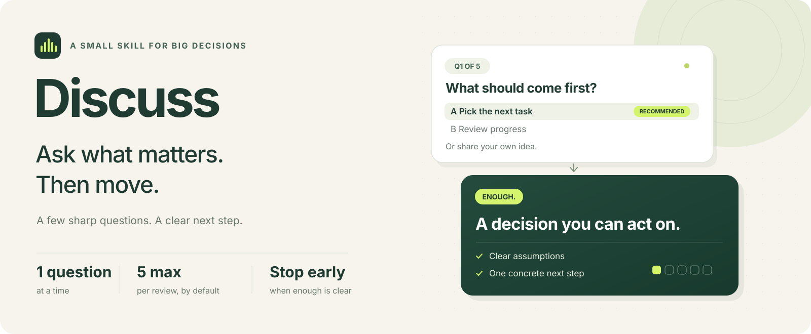

<p align="center">
  
</p>

<p align="center">
  <strong>问到关键处，就往前走。</strong><br>
  带上你的方案，聊清几个关键问题，得到建议和一个具体的下一步。
</p>

<p align="center">
  <a href="README.md">English</a> ·
  <a href="SKILL.md">技能规则</a> ·
  <a href="https://github.com/HUHANG716/discuss/releases/latest">下载安装包</a> ·
  <a href="LICENSE">MIT 许可证</a>
</p>

---

## 先用起来

通过 [Skills CLI](https://github.com/vercel-labs/skills) 安装：

```sh
npx skills add HUHANG716/discuss --skill discuss
```

然后把方案交给助手。在 Codex 中可以这样说：

```text
用 $discuss 帮我检查这个方案：……
```

也可以直接说“讨论一下这个方案”“discuss 一下这个想法”或“grill 一下这个方案”，相近的讨论表达也适用。

原名 `grill-lite`，现在的技能名称和安装文件夹都是 `discuss`。

<details>
<summary><strong>Codex：全局安装</strong></summary>

```sh
npx skills add HUHANG716/discuss --skill discuss --agent codex --global
```

</details>

## 一次完整的讨论，可以这么短

*以下为示例对话。一次有效回答就可能足够。*

**你**

> 我想把个人任务管理工具重做成一个 Web 应用，用 discuss 帮我看看。

**Discuss**

> 🍢 **1/5：第一版优先解决什么？**
>
> - **A. 不知道先做什么（推荐）**
> - B. 忘记任务
> - C. 看不清进度
>
> 🔥 先让第一版有一个明确的用途。
>
> 回复字母，或直接说你的想法。

**你**

> 其实我想解决的是任务太模糊，不知道怎么开始。只给我自己用，不需要同步。

**Discuss · 收尾**

> **建议：** 先做一个本地的任务拆解原型，把模糊任务变成可执行的下一步。
>
> **你已确定：** 只给你自己用、不需要同步、重点是拆出下一步行动。
>
> **我采用的假设：** 第一版由你手动补充下一步行动就够了。
>
> **下一步：** 画出任务名称、下一步行动和开始按钮三个元素。
>
> 🍢 **开始确认：要先画出这一页的草图吗？**
>
> - **A. 开始画草图（推荐）**
> - B. 调整方案（直接说改哪里）
> - C. 先到这里
>
> 🔥 用一页草图就能检查这条流程是否顺畅。
>
> 回复字母，或直接说你的想法。

你提出了选项之外的方向，助手就跟着你的想法调整。一道讨论题已经足够给出结论，随后单独确认是否开始画草图，等你选择后再执行。

## 问得少，仍然问到点上

| 规则 | 带来的体验 |
| --- | --- |
| **一次只问一题** | 你回答后，再决定是否继续问下一题。 |
| **2–3 个选项，标明推荐项** | 选项简短，推荐项排在第一位。 |
| **随时说出自己的想法** | 每题都提示可以自由回答，组合、修改或跳出选项都可以。 |
| **讨论最多 5 题** | 整段讨论共用一个预算，追问也计入。 |
| **固定 🍢 / 🔥 格式** | 问题一句话，推荐理由一句话，一眼就能看懂。 |
| **小选择采用默认值** | 可逆的细节交给助手，并清楚标明假设。 |
| **信息足够就收尾** | 能给结论就停，剩余题数不用凑满。 |
| **明确确认是否开始** | 下一步可执行时，让你选择开始、调整或先停；已经授权执行时直接继续。 |

Discuss 聚焦会改变方向、范围或可行性的选择。推荐会参考已知约束和你已经确认的决定；若推荐改变现有职责或范围，会说明收益和代价。次要、可逆的细节可以采用标明的默认假设，减少追问。每题给出选项，等待你回答。推荐项供你参考，后续讨论跟着你的实际回答调整。

## 节奏由你定

| 你说 | 助手就会 |
| --- | --- |
| `讨论最多三题。` | 使用更小的讨论题预算，仍然逐个提问。 |
| `重点看哪些地方可能让方案失败。` | 优先检查影响最大的风险。 |
| `先给结论。` | 立即收尾，给出建议和下一步。 |
| `过一下方案，然后直接实现。` | 讨论结束后，按你的授权继续执行。 |

上限不是配额。信息足够明确的方案可以**零讨论题**。需要更深入时，你也可以主动要求继续。

## 放进你正在用的助手

核心就是一份 [SKILL.md](SKILL.md)：纯 Markdown，不需要运行脚本、配置 API 密钥或依赖外部服务。支持 Agent Skills 格式的助手即可使用。Skills CLI 支持 Codex、Claude Code、Cursor 等助手，安装时选择你使用的工具。

技能规则使用英文，讨论会跟随你的语言；中文提问、中文收尾都可以。

```text
用 $discuss 帮我检查这个方案。讨论时一次只问一题，全程最多五题。
```

<details>
<summary><strong>手动安装</strong></summary>

将 `SKILL.md` 和可选的 `agents/` 文件夹放到助手技能目录下的 `discuss` 文件夹。分发副本时保留 `LICENSE`。

Codex 的用户级路径之一为 `~/.agents/skills/discuss/`，详见[官方技能文档](https://learn.chatgpt.com/docs/build-skills)。

</details>

<details>
<summary><strong>提问上限如何计算</strong></summary>

预算覆盖整段讨论。每题只涉及一个决策，提供 2–3 个选项和推荐项，等你回答后再继续。开场提问和对方案细节的确认也计数。收尾时的一次执行选择与默认讨论题预算分开计算，用来确认是否开始，不再夹带方案问题。如果你明确限制全部提问或轮次，执行确认也要遵守这个总上限。

助手会先总结具体行动和范围，再确认是否开始。已经授权执行时直接继续；只要建议、要求停止、仍有关键缺口，或下一步超出助手能力时，就以结论结束。

这个上限依靠模型遵循指令，并非程序强制计数。[人工行为检查场景](EVALS.md)覆盖问题计数、提前停止、自定义上限和执行边界，供评估使用，不代表已通过自动化行为测试。

</details>

## 一起把问题问得更准

欢迎提供一个小例子：哪次追问改变了你的决定，或者哪次已经可以收尾，助手却还在问。[提交 Issue](https://github.com/HUHANG716/discuss/issues)，也欢迎提出具体改进。

好的改进，应该让下一位使用者少一些不必要的来回，更快做出有依据的决定。

---

灵感来自 [Matt Pocock 的 grilling 技能](https://github.com/mattpocock/skills/blob/main/skills/productivity/grilling/SKILL.md)。规则独立编写，采用提问上限和明确的提前停止条件。

使用 [MIT 许可证](LICENSE)开源，欢迎使用、修改和分享。
